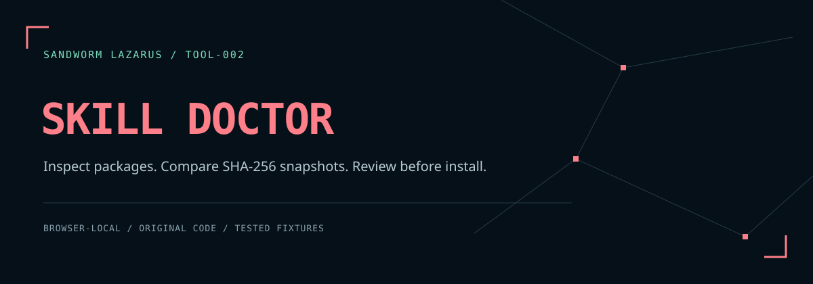

# Sandworm Skill Doctor



Inspect a skill package before installing it: review basic metadata, selected-file references, license-file presence, and exact UTF-8 content changes through SHA-256 snapshots. The web workflow runs in the browser; an optional Node CLI uses the same engine. Skills and links are never executed or fetched.

**v0.1.0 · Original Sandworm implementation · [ภาษาไทย](README.th.md)**

The dark navy/coral interface follows [Sandworm Lazarus](https://sandworm-lazarus.pages.dev/) with self-hosted Thai/Latin fonts, an original network illustration, responsive panels, and keyboard navigation.

## Node CLI

Use the same inspection/snapshot engine in local scripts or CI. Node.js 20+; no dependencies.

```sh
node cli/skill-doctor.cjs check ./path/to/skill --json
node cli/skill-doctor.cjs snapshot ./path/to/skill --output ./baseline.json
node cli/skill-doctor.cjs compare ./baseline.json ./current.json --json
```

[CLI commands, exit codes and filesystem boundaries](docs/CLI.md) · [คู่มือภาษาไทย](docs/CLI.th.md). Hosted native checks for this feature are pending execution; older validation reports do not certify the new CLI.

## Run

No install or build step is needed. Use Python 3:

```sh
python3 -m http.server 8080 --bind 127.0.0.1 --directory dist
```

Open `http://127.0.0.1:8080`. SHA-256 needs a secure browser context (HTTPS or localhost); direct `file://` launch is not a supported guarantee. The static files have no external runtime assets, uploads, analytics, cookies, or local history storage.

## Workflow

1. Choose **ลองข้อมูลตัวอย่าง**, paste a root `SKILL.md`, or select UTF-8 files/a package folder. A new file selection replaces the previously imported set.
2. Click **ตรวจและสร้าง snapshot**. Read the findings; no findings does not establish safety.
3. Optionally paste/import an earlier `skill-snapshot.json`, then compare added, removed, changed, and unchanged paths.
4. Review the file names and enable the export checkbox. Download a snapshot or review report. Exports contain file paths and hashes, but no original file content or metadata values.

The editable source box represents only root `SKILL.md`. Imported root content retains its original BOM and line endings for hashing until you edit that box; after editing, the edited textarea text is the source of truth. Files such as `skills/example/SKILL.md` remain in the selected package and are inspected independently. Folder selection removes the selected root folder's name, preserving relative paths. Individual file selection exposes basenames only; use the folder picker to preserve subdirectories.

## Exact inspection scope

- Frontmatter must start with `---` and close within 128 content lines. It supports one-line `key: value` fields, blank lines, comment-only lines, JSON-style double-quoted strings, and single-quoted strings with doubled quote escapes. Nested mappings, arrays, block scalars, anchors, tags, and inline comments are outside the supported subset. This is **not a full YAML parser** or a claim of compatibility with every skill platform.
- Local name policy: 1–64 lower-case ASCII letters/digits separated by single hyphens. Description: nonempty, at most 1,024 JavaScript string code units. Unknown simple scalar fields are accepted but not interpreted.
- A deliberately limited Markdown-link heuristic checks `[label](target)` without spaces/parentheses in the target. Reference-style links, HTML links, code references, and all Markdown grammar are not parsed. Matches inside code blocks can be false positives.
- Relative link resolution is case-sensitive and checks only the selected files. A missing link can mean the package selection is incomplete. Escapes beyond the selected package are flagged. External links are reported but never opened.
- A nonempty `LICENSE`, `LICENCE`, or `COPYING` filename indicates presence only. It does not identify the license, establish ownership, or decide legal compatibility.
- A `curl/wget ... | sh/bash` heuristic is a review prompt; it is not a malware or prompt-injection detector.

## Snapshots and limits

The `sandworm.skill-snapshot.v1` format stores sorted relative file paths, exact UTF-8 byte counts, and lowercase SHA-256 hashes. Text is not newline-normalized. The metadata inspector strips an initial BOM for parsing, but the snapshot hashes the original content, including that BOM and all line endings.

Limits: **64 files**, **128 KiB per file**, **1 MiB total**, **240 path characters**, **2,048 matched links**, and **128 KiB imported snapshot JSON**. Invalid UTF-8 and duplicate paths are rejected. Absolute paths, backslashes, control characters, empty segments, `.` and `..` segments are rejected for selected-file names. Relative Markdown references may use `..` while staying within the package.

Hashes detect differences; they are neither signatures nor proof of provenance. Paths can still reveal sensitive metadata; review them before exporting. See [the threat model](docs/THREAT_MODEL.md).

## Verification

Node.js 20+ is required for tests. No dependencies are installed.

```sh
npm test
npm run check
```

The check command runs tests and static verification, then writes `reports/validation.json` with SHA-256 source/fixture digests. Changed source produces changed digests. Runtime checks are described in [development notes](docs/DEVELOPMENT.md); hosted CI status must be read from the actual run.

## API

```js
const doctor = require('./dist/engine.js');
const files = [{ path: 'SKILL.md', content: '---\nname: demo\ndescription: Example\n---\n' }];
const findings = doctor.inspectPackage(files);
const snapshot = await doctor.createSnapshot(files);
const previous = doctor.parseSnapshot(savedJson);
const differences = doctor.compareSnapshots(previous, snapshot);
```

## License

Original code is MIT. Bundled fonts retain SIL OFL 1.1; see [third-party notices](THIRD_PARTY_NOTICES.md). Example package files are synthetic fixtures, not third-party skills. The tool does not grant rights to packages that users inspect.

## Sandworm tools

[Thai Eval Studio](https://github.com/Sandworm-Lazarus/sandworm-thai-eval) · [GameGuard Lab](https://github.com/Sandworm-Lazarus/sandworm-gameguard-lab) · [AI Run Ledger](https://github.com/Sandworm-Lazarus/sandworm-ai-run-ledger) · [Agent Gate](https://github.com/Sandworm-Lazarus/sandworm-agent-gate) · [Privacy Workbench](https://github.com/Sandworm-Lazarus/sandworm-privacy-workbench)
