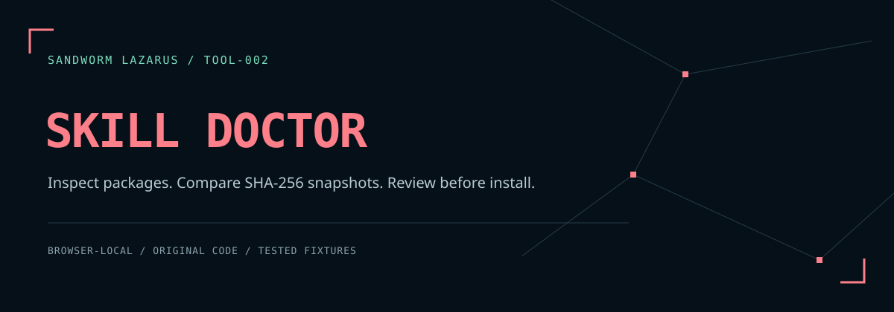

# Sandworm Skill Doctor



เครื่องมือตรวจแพ็กเกจ skill ก่อนติดตั้ง: ตรวจ metadata ลิงก์ไฟล์ที่เลือก และการมีไฟล์ license พร้อมสร้างและเทียบ SHA-256 snapshot ภายในเบราว์เซอร์ ไม่เรียกใช้คำสั่งของ skill และไม่เปิด URL

**v0.1.0 · โค้ดที่พัฒนาสำหรับ Sandworm · [English](README.md)**

ใช้ธีมดำอมฟ้า–แดงคอรัลจาก [เว็บ Sandworm Lazarus](https://sandworm-lazarus.pages.dev/) ฟอนต์ไทยและอังกฤษอยู่ในโปรเจกต์ พร้อมภาพเครือข่ายที่สร้างขึ้นใหม่

## ใช้ผ่าน CLI

ใช้ engine เดียวกับหน้าเว็บในสคริปต์หรือ CI ต้องมี Node.js 20 ขึ้นไป ไม่ต้องติดตั้ง dependency

```sh
node cli/skill-doctor.cjs check ./path/to/skill --json
node cli/skill-doctor.cjs snapshot ./path/to/skill --output ./baseline.json
node cli/skill-doctor.cjs compare ./baseline.json ./current.json --json
```

[คำสั่ง exit code และขอบเขตไฟล์](docs/CLI.th.md) · [English](docs/CLI.md) การรัน native checks ของ feature นี้บน hosted runner ยังรอตรวจสอบ รายงาน validation เดิมไม่ได้รับรอง CLI ใหม่

## เปิดใช้งาน

```sh
python3 -m http.server 8080 --bind 127.0.0.1 --directory dist
```

เปิด `http://127.0.0.1:8080` ไม่ต้องติดตั้งแพ็กเกจหรือ build และไม่มีการส่งเนื้อหาออกไป การคำนวณ SHA-256 ต้องเปิดผ่าน HTTPS หรือ localhost ไม่รับรองการเปิด `file://` โดยตรง

1. กดลองข้อมูลตัวอย่าง หรือวาง root `SKILL.md` และเลือกไฟล์ประกอบ
2. เลือกโฟลเดอร์เมื่อมีไฟล์ในโฟลเดอร์ย่อย เพื่อเก็บพาธสัมพัทธ์ให้ครบ การเลือกชุดใหม่จะแทนชุดที่นำเข้าก่อนหน้า
3. กดตรวจและสร้าง snapshot แล้วอ่านข้อสังเกต
4. นำเข้า snapshot เก่าเพื่อเปรียบเทียบไฟล์เพิ่ม ลบ เปลี่ยน และตรงเดิม
5. ตรวจชื่อไฟล์ก่อนกดยืนยันส่งออก รายงานมีพาธและแฮช แต่ไม่มีเนื้อหาไฟล์

## ขอบเขตที่ต้องรู้

- รองรับ frontmatter แบบ `key: value` บรรทัดเดียว รวมข้อความในเครื่องหมายคำพูด รูปแบบซ้อนหรือข้อความหลายบรรทัดจะถูกแจ้งให้ตรวจเอง ตัวตรวจนี้ไม่ใช่ YAML parser เต็มรูปแบบ
- กฎชื่อของเครื่องมือ: ตัวอักษรอังกฤษเล็ก ตัวเลข และขีดกลาง 1–64 ตัวอักษร; description ไม่ว่างและไม่เกิน 1,024 code units
- ตรวจลิงก์ Markdown รูปแบบง่าย `[ข้อความ](พาธ)` ไม่ครอบคลุมทุกไวยากรณ์และอาจเจอข้อความใน code block ด้วย
- แยกตัวพิมพ์เล็ก–ใหญ่ของพาธ ไฟล์ที่ไม่เลือกอาจถูกแจ้งว่าหาย จึงต้องนำเข้าแพ็กเกจให้ครบ
- ตรวจเพียงว่ามีไฟล์ LICENSE/LICENCE/COPYING ที่ไม่ว่าง ไม่ตัดสินเงื่อนไขหรือความเข้ากันได้ของ license
- แจ้งเตือนรูปแบบคำสั่งดาวน์โหลดแล้วส่งเข้า shell เพื่อให้มนุษย์ตรวจ ไม่ใช่การตรวจจับมัลแวร์หรือ prompt injection ที่ครบถ้วน
- SHA-256 ตรวจการเปลี่ยนแปลง ไม่ยืนยันผู้เขียนหรือลายเซ็น และไม่แปลว่า skill ปลอดภัย

รองรับ 64 ไฟล์ สูงสุดไฟล์ละ 128 KiB รวม 1 MiB; พาธไม่เกิน 240 ตัวอักษร; ลิงก์ที่ตรงรูปแบบไม่เกิน 2,048 รายการ; snapshot JSON สูงสุด 128 KiB ไฟล์ต้องเป็น UTF-8 แฮชคำนวณจากข้อความเดิมโดยไม่ปรับ newline

## ทดสอบ

ต้องใช้ Node.js 20+ ไม่มี dependency เพิ่ม

```sh
npm test
npm run check
```

คำสั่ง check ออกรายงาน reports/validation.json พร้อม SHA-256 ของ source และ fixture เพื่อระบุโค้ดที่ใช้ตรวจได้ อ่าน [บันทึกการพัฒนา](docs/DEVELOPMENT.md) และ [ขอบเขตความปลอดภัย](docs/THREAT_MODEL.md) ก่อนนำไปประยุกต์

โค้ดของเราใช้ MIT ส่วนฟอนต์ใช้ SIL OFL 1.1 ตาม [Third-party notices](THIRD_PARTY_NOTICES.md) ชุดตัวอย่างเป็นข้อมูลสมมติ

## Sandworm tools

[Thai Eval Studio](https://github.com/Sandworm-Lazarus/sandworm-thai-eval) · [GameGuard Lab](https://github.com/Sandworm-Lazarus/sandworm-gameguard-lab) · [AI Run Ledger](https://github.com/Sandworm-Lazarus/sandworm-ai-run-ledger) · [Agent Gate](https://github.com/Sandworm-Lazarus/sandworm-agent-gate) · [Privacy Workbench](https://github.com/Sandworm-Lazarus/sandworm-privacy-workbench)
